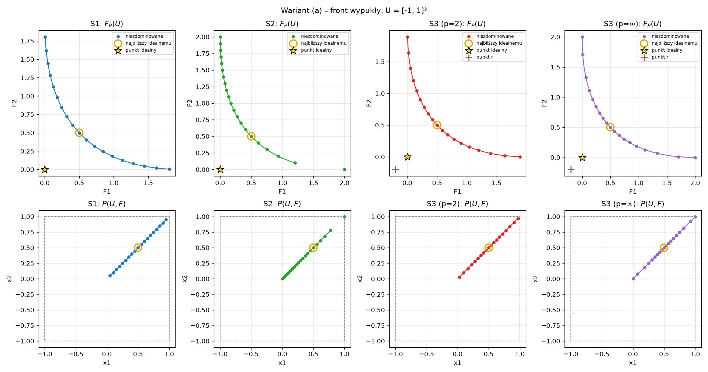
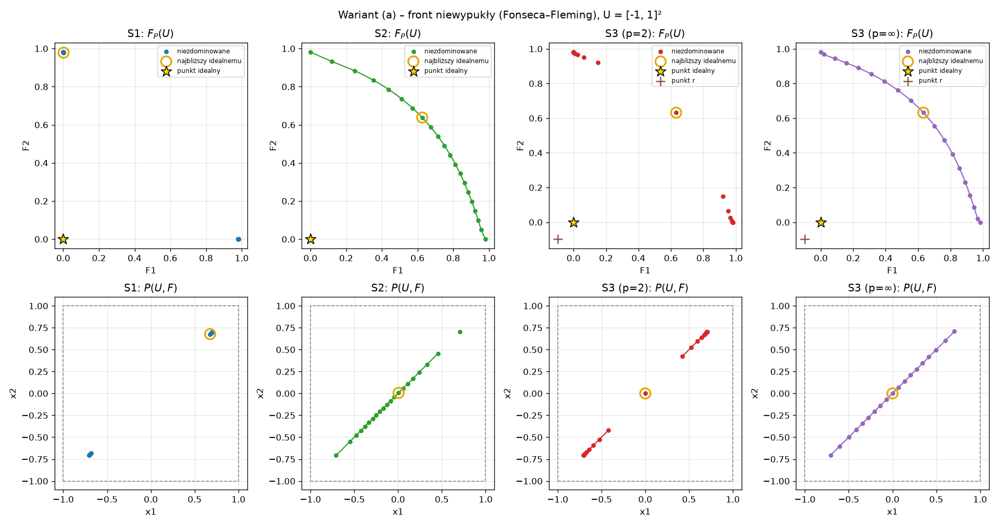
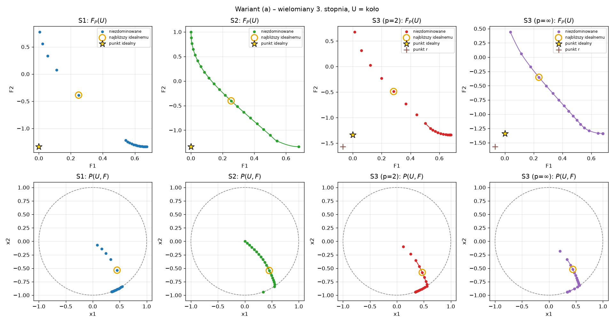
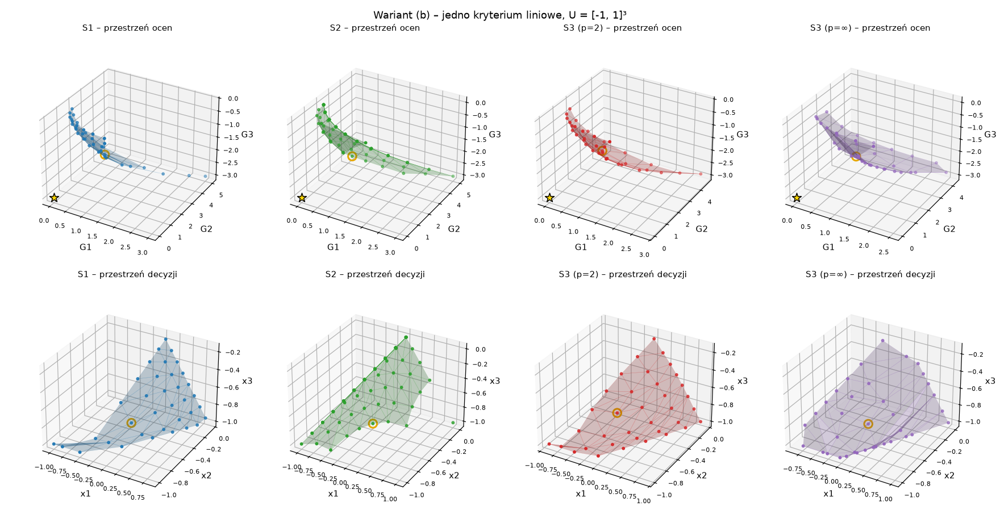
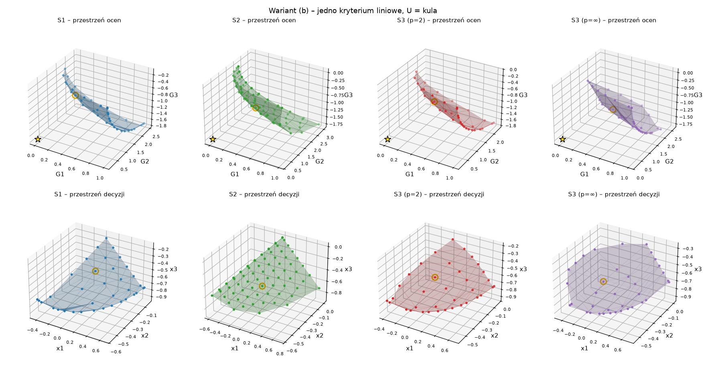

# 1. Cel ćwiczenia

Celem ćwiczenia było praktyczne zastosowanie trzech podstawowych metod skalaryzacji do wyznaczenia dyskretnej aproksymacji zbioru rozwiązań niezdominowanych $P(U,F)$ oraz zbioru ocen niezdominowanych $F_P(U)$ w problemie

$$
[F : U \to \mathbb{R}^N] \to \min(\theta), \qquad \theta = \mathbb{R}^N_+ ,
$$

czyli przy naturalnym porządku częściowym w $\mathbb{R}^N$ (wszystkie kryteria minimalizujemy). Zadanie wykonano w dwóch wariantach:

a) problem dwukryterialny $F = (F_1, F_2)$, $U \subset \mathbb{R}^2$, w którym **obie** funkcje celu są nieliniowe,

b) problem trójkryterialny $G = (G_1, G_2, G_3)$, $U \subset \mathbb{R}^3$, w którym **co najmniej jedna** funkcja jest nieliniowa.

Metody zaimplementowano w Pythonie jako część aplikacji Streamlit rozwijanej w poprzednich ćwiczeniach (strona „Skalaryzacja”). Zamiast `fmincon()` z Matlaba zastosowano jego odpowiednik, czyli funkcję `scipy.optimize.minimize` z metodą SLSQP.

# 2. Podstawy teoretyczne

## 2.1. Rozwiązania niezdominowane

Punkt $u \in U$ jest **niezdominowany** (optymalny w sensie Pareto), jeżeli nie istnieje $v \in U$ takie, że $F_i(v) \le F_i(u)$ dla każdego $i$ i $F_k(v) < F_k(u)$ dla pewnego $k$. Zbiór takich punktów oznaczamy $P(U,F)$, a zbiór ich ocen $F_P(U) = F(P(U,F))$ to **front Pareto**.

W ćwiczeniach 1–2 zbiór $U$ był skończony, więc $P$ dało się wyznaczyć przez filtrację. Tutaj $U$ jest zbiorem ciągłym, a $P(U,F)$ to zwykle nieskończony zbiór (krzywa lub powierzchnia). **Skalaryzacja** zastępuje problem wektorowy rodziną zadań jednokryterialnych $\min_{u\in U} S(F(u), \text{parametr})$. Każde z nich rozwiązuje się standardową metodą optymalizacji z ograniczeniami. Przy odpowiednich założeniach rozwiązanie każdego zadania jest punktem (słabo) niezdominowanym. Zmieniając parametr ze stałym krokiem $\rho$, dostajemy ciąg punktów frontu, czyli jego dyskretną aproksymację.

## 2.2. Tablica wypłat, punkt idealny i nadir

Dla każdego kryterium $i$ rozwiązujemy $\min_{u \in U} F_i(u)$ i zapisujemy wektor $F(u_i^*)$ jako $i$-ty wiersz tablicy wypłat. Jeśli minimum nie jest jednoznaczne, drugi etap minimalizuje sumę pozostałych kryteriów przy $F_i \le F_i^* + \varepsilon$ (porządek leksykograficzny), żeby wiersz był punktem niezdominowanym. Z tablicy otrzymujemy:

- **punkt idealny** $F^* = (\min F_1, \dots, \min F_N)$, czyli przekątną tablicy,
- **nadir** $F^{\mathrm{nad}}$, czyli maksima kolumn tablicy (standardowe oszacowanie nadiru).

Oba punkty wyznaczają zakres frontu. Służą do normalizacji parametrów S2, do wyboru punktu odniesienia w S3 i do wskazania rozwiązania kompromisowego.

## 2.3. S1 – skalaryzacja przez funkcję liniową

$$
S_1(u, \lambda) = \sum_{i=1}^{N} \lambda_i F_i(u), \qquad \lambda_i > 0,\ \ \sum_i \lambda_i = 1 .
$$

Geometrycznie szukamy punktu, w którym hiperpłaszczyzna o normalnej $\lambda$ jest styczna do zbioru $F(U)$. Każde rozwiązanie przy $\lambda > 0$ jest niezdominowane. Metoda znajduje jednak **tylko punkty wspierane**, czyli takie, które leżą na wypukłej otoczce $F(U)$. Fragmentów frontu, które nie są wypukłe, nie osiągnie przy żadnym $\lambda$.

**Siatka parametrów:** $\lambda_i = c_i / k$, gdzie $k = 1/\rho$, $c_i \in \{1, \dots, k-1\}$ oraz $\sum c_i = k$. To wnętrze sympleksu, bo warunek $\lambda > 0$ wyklucza jego brzeg. Daje to $\binom{k-1}{N-1}$ zadań.

## 2.4. S2 – metoda $\varepsilon$-ograniczeń

$$
S_2(u, a, j) = F_j(u) \quad \text{przy ograniczeniach} \quad F_i(u) \le a_i,\ \ i \ne j .
$$

Jedno kryterium minimalizujemy, a pozostałe ograniczamy z góry. Metoda osiąga również punkty niewspierane, czyli te z niewypukłych fragmentów frontu. Może jednak zwrócić punkty tylko **słabo** niezdominowane, które trzeba potem odfiltrować. Dla zbyt ciasnych ograniczeń zadanie może nie mieć rozwiązania dopuszczalnego.

**Siatka parametrów:** znormalizowane poziomy $z_i \in \{0, \rho, 2\rho, \dots, 1\}$ oraz $a_i = F_i^* + z_i\,(F_i^{\mathrm{nad}} - F_i^*)$. Daje to $(k+1)^{N-1}$ zadań. W eksperymentach minimalizowano $F_1$ ($j = 1$).

## 2.5. S3 – odległość od punktu dominującego

$$
S_3(u, r, \lambda, p) = \lVert F(u) - r \rVert_{\lambda,p} =
\Big( \sum_{i=1}^{N} \big(\lambda_i\,|F_i(u) - r_i|\big)^p \Big)^{1/p},
\qquad
\lVert y \rVert_{\lambda,\infty} = \max_i \lambda_i |y_i| .
$$

Punkt odniesienia $r$ musi dominować cały front. Przyjęto

$$
r = F^* - \delta\,(F^{\mathrm{nad}} - F^*), \qquad \delta = 0{,}1 ,
$$

czyli punkt nieco lepszy od idealnego. Dla $p = \infty$ (metryka Czebyszewa) można otrzymać **każdy** punkt niezdominowany, także z niewypukłej części frontu, choć mogą pojawić się punkty słabo niezdominowane. Dla $p < \infty$ zbiory poziomic normy są „zaokrąglone”, więc część niewypukłego frontu bywa nieosiągalna. Przy $p = 1$ metoda sprowadza się do S1.

Funkcja $\max$ nie jest różniczkowalna, a metody gradientowe radzą sobie z nią słabo. Dlatego dla $p = \infty$ zadanie przekształcono do równoważnej gładkiej postaci ze zmienną pomocniczą $t$:

$$
\min_{u \in U,\ t \in \mathbb{R}} t \quad \text{przy} \quad \lambda_i\,(F_i(u) - r_i) \le t,\ \ i = 1,\dots,N .
$$

Siatka $\lambda$ jest taka sama jak w S1.

## 2.6. Rozwiązanie kompromisowe

Spośród otrzymanych punktów niezdominowanych wskazano punkt **najbliższy punktowi idealnemu** w metryce euklidesowej, po normalizacji każdego kryterium jego zakresem:

$$
d(u) = \Big\lVert \frac{F(u) - F^*}{F^{\mathrm{nad}} - F^*} \Big\rVert_2 .
$$

Normalizacja jest konieczna, bo kryteria mają różne zakresy wartości (w wariancie b od $-3$ do $5$).

# 3. Implementacja

Kod znajduje się w pliku `owd/scalarization.py` (obliczenia) oraz `app_pages/scalarization_page.py` (interfejs Streamlit).

| Element | Realizacja |
|---|---|
| Wprowadzanie funkcji | formuły w zmiennych `x1, x2, x3` parsowane przez `sympy` (np. `x1**2 + (x2-1)**2`, `exp(-x1)`); gotowe zestawy i możliwość edycji |
| Kontrola nieliniowości | funkcja jest liniowa (afiniczna) $\iff$ jej hesjan $\nabla^2 F_i \equiv 0$; sprawdzane symbolicznie (`sympy.hessian` + uproszczenie). W wariancie (a) przycisk „Oblicz” jest zablokowany, gdy $F_1$ lub $F_2$ jest liniowa, a w (b), gdy wszystkie trzy są liniowe |
| Gradienty | dokładny jakobian z `sympy` (`Matrix.jacobian`) przekształcony do funkcji numpy (`lambdify`); w S3 dla skończonego $p$ gradient przybliżany różnicowo przez scipy |
| Solver | `scipy.optimize.minimize(method="SLSQP")` (odpowiednik `fmincon`); kwadrat/sześcian jako `Bounds`, koło/kula oraz ograniczenia S2 i S3-$\infty$ jako `NonlinearConstraint` |
| Wielostart | 3 punkty startowe z hipersześcianu łacińskiego (`scipy.stats.qmc`) w kwadracie lub losowe w kole (`scipy.stats.uniform_direction`) oraz rozwiązanie dla poprzedniej wartości parametru; wybierane jest najlepsze rozwiązanie zgłoszone przez SLSQP jako poprawne |
| Brak rozwiązania | jeżeli żaden start nie zakończy się sukcesem (np. sprzeczne ograniczenia w S2), zadanie oznaczane jest jako nierozwiązane |
| Filtracja | otrzymane oceny przechodzą przez algorytm filtracji z ćwiczenia 1 (`owd/algorithms/with_filtration.py`); punkty zdominowane (np. słabo niezdominowane z S2) są oznaczane; powtórzenia (ten sam punkt dla różnych parametrów) są wykrywane |
| Wizualizacja | Plotly w aplikacji, matplotlib w tym sprawozdaniu (`generate_figures.py`) |

## 3.1. Dobór procedury spline

Instrukcja wymaga połączenia otrzymanych punktów spline'ami i doboru odpowiedniej procedury. Zastosowano:

- **Przestrzeń ocen (2D)** – `scipy.interpolate.PchipInterpolator`, czyli monotoniczny kawałkami sześcienny spline Hermite'a $F_2(F_1)$. Front dwukryterialny jest zawsze funkcją nierosnącą. Zwykły spline sześcienny mógłby między węzłami wykonać oscylację w górę i narysować fragment krzywej, który jest zdominowany, co przeczy definicji frontu. PCHIP zachowuje monotoniczność danych.
- **Przestrzeń decyzji (2D)** – zbiór $P(U,F)$ nie musi być wykresem funkcji $x_2(x_1)$, bo może zawracać. Dlatego zastosowano parametryczny spline sześcienny (`make_interp_spline`) z parametrem równym skumulowanej długości łamanej (*chord-length*). Punkty uporządkowano wzdłuż frontu, czyli według $F_1$.
- **Nieciągłości** – front może być niespójny, a S1 na niewypukłym froncie zostawia lukę. Krzywą rozcina się więc tam, gdzie odstęp między kolejnymi punktami przekracza 4-krotność mediany odstępów. Spline nie „wymyśla” wtedy frontu tam, gdzie metoda nie znalazła punktów.
- **Wariant 3D** – front jest powierzchnią. Punkty połączono siatką trójkątów z triangulacji Delaunaya siatki parametrów $(\lambda$ lub $z)$ (`scipy.spatial.Delaunay`), z pominięciem trójkątów o zbyt długich krawędziach.

# 4. Badane problemy

Parametry wspólne: krok $\rho = 0{,}05$ w wariancie (a) i $\rho = 0{,}1$ w wariancie (b), 3 punkty startowe + rozwiązanie poprzednie, seed 0, $\delta = 0{,}1$, w S2 minimalizowane kryterium 1, w S3 $p = 2$ oraz $p = \infty$.

| Id | Wariant | Funkcje | $U$ |
|---|---|---|---|
| a1 | (a) front wypukły | $F_1 = x_1^2 + x_2^2$, $F_2 = (x_1-1)^2 + (x_2-1)^2$ | $[-1,1]^2$ |
| a2 | (a) front niewypukły (Fonseca–Fleming) | $F_{1,2} = 1 - \exp\!\big(-(x_1 \mp \tfrac{\sqrt2}{2})^2 - (x_2 \mp \tfrac{\sqrt2}{2})^2\big)$ | $[-1,1]^2$ |
| a3 | (a) wielomiany 3. stopnia | $F_1 = x_1^2 + x_2^2 + x_1 x_2$, $F_2 = (x_1-1)^2 + x_2^3 + x_2$ | koło $x_1^2 + x_2^2 \le 1$ |
| b1 | (b) jedno kryterium liniowe | $G_1 = \lVert x\rVert^2$, $G_2 = (x_1-1)^2 + x_2^2 + (x_3+1)^2$, $G_3 = x_1 + x_2 + x_3$ | $[-1,1]^3$ |
| b2 | (b) jak wyżej | jak b1 | kula $\lVert x \rVert \le 1$ |

Wszystkie funkcje w (a) mają niezerowy hesjan, więc są nieliniowe. W (b) $G_1$ i $G_2$ są nieliniowe, a $G_3$ jest liniowa, co wariant (b) dopuszcza.

**Rozwiązanie analityczne a1.** $F_1$ i $F_2$ to kwadraty odległości od punktów $(0,0)$ i $(1,1)$. Rozwiązania niezdominowane leżą na łączącym je odcinku:

$$
P(U,F) = \{(t,t) : t \in [0,1]\}, \qquad F_P(U) = \{(2t^2,\ 2(1-t)^2)\} = \{F : \sqrt{F_1} + \sqrt{F_2} = \sqrt{2}\}.
$$

**Rozwiązanie analityczne a2.** $P(U,F)$ to odcinek $x_1 = x_2 \in [-\tfrac{\sqrt2}{2}, \tfrac{\sqrt2}{2}]$, a front jest wklęsły (niewypukły). To klasyczny przykład, na którym zawodzi S1.

# 5. Wyniki

Oznaczenia w tabelach:

- **zadań** – liczba wartości parametru,
- **rozwiązanych** – zadania z rozwiązaniem dopuszczalnym,
- **niezd.** – liczba rozwiązań niezdominowanych po filtracji,
- **unikalnych** – niezdominowane bez powtórzeń,
- $d_2$ – znormalizowana odległość rozwiązania kompromisowego od punktu idealnego.

Na wykresach górny wiersz to przestrzeń ocen $F_P(U)$, a dolny przestrzeń decyzji $P(U,F)$. Złote kółko oznacza rozwiązanie najbliższe punktowi idealnemu (gwiazdka), a krzyżyk punkt odniesienia $r$ metody S3.

## 5.1. Wariant (a), front wypukły (a1)

Tablica wypłat: $\min F_1 \Rightarrow F = (0{,}000;\ 1{,}999)$, $\min F_2 \Rightarrow F = (1{,}999;\ 0{,}000)$. Stąd $F^* = (0, 0)$, $F^{\mathrm{nad}} = (1{,}999;\ 1{,}999)$, $r = (-0{,}2;\ -0{,}2)$.

| metoda | zadań | rozwiązanych | niezd. | unikalnych | czas [s] | kompromis $x$ | $F(x)$ | $d_2$ |
|---|---|---|---|---|---|---|---|---|
| S1 | 19 | 19 | 19 | 19 | 0,01 | (0,500; 0,500) | (0,500; 0,500) | 0,3537 |
| S2 | 21 | 21 | 21 | 21 | 0,03 | (0,500; 0,500) | (0,500; 0,500) | 0,3537 |
| S3, $p=2$ | 19 | 19 | 19 | 19 | 0,03 | (0,500; 0,500) | (0,500; 0,500) | 0,3537 |
| S3, $p=\infty$ | 19 | 19 | 19 | 19 | 0,02 | (0,500; 0,500) | (0,500; 0,500) | 0,3537 |

Zgodność z rozwiązaniem analitycznym, liczona jako największy błąd po wszystkich punktach niezdominowanych:

| metoda | $\max \lvert \sqrt{F_1} + \sqrt{F_2} - \sqrt2 \rvert$ | $\max \lvert x_1 - x_2 \rvert$ |
|---|---|---|
| S1 | $1{,}2\cdot10^{-11}$ | $1{,}8\cdot10^{-6}$ |
| S2 | $5{,}7\cdot10^{-13}$ | $6{,}9\cdot10^{-7}$ |
| S3, $p=2$ | $9{,}0\cdot10^{-13}$ | $1{,}1\cdot10^{-6}$ |
| S3, $p=\infty$ | $5{,}6\cdot10^{-10}$ | $1{,}3\cdot10^{-6}$ |



Wszystkie metody wyznaczają ten sam front z dokładnością rzędu tolerancji solvera. Wszystkie wskazują ten sam kompromis $x = (0{,}5;\ 0{,}5)$, czyli środek odcinka $P(U,F)$. Metody różnią się **rozmieszczeniem punktów** na froncie:

- S1 i S3 nie osiągają końców frontu, bo $\lambda_i > 0$, a najbardziej skrajne wagi to $0{,}05$ i $0{,}95$.
- S2 osiąga oba końce, bo poziomy $z$ obejmują 0 i 1. Punkty S2 są rozłożone równomiernie w $F_2$, więc gęsto tam, gdzie front jest stromy, i rzadko na jego płaskiej części. Przy $F_1 \to 2$ powstaje luka, przez którą spline nie jest prowadzony.

## 5.2. Wariant (a), front niewypukły (a2)

$F^* = (0, 0)$, $F^{\mathrm{nad}} = (0{,}982;\ 0{,}982)$.

| metoda | zadań | rozwiązanych | niezd. | unikalnych | czas [s] | kompromis $x$ | $F(x)$ | $d_2$ | największa luka $\Delta F_1$ |
|---|---|---|---|---|---|---|---|---|---|
| S1 | 19 | 19 | 19 | 19 | 0,02 | (0,677; 0,677) | (0,002; 0,978) | 0,9966 | 0,977 |
| S2 | 21 | 21 | 21 | 21 | 0,06 | (0,006; 0,006) | (0,626; 0,638) | 0,9107 | 0,128 |
| S3, $p=2$ | 19 | 19 | 19 | 19 | 0,04 | (0,000; 0,000) | (0,632; 0,632) | 0,9107 | 0,482 |
| S3, $p=\infty$ | 19 | 19 | 19 | 19 | 0,04 | (0,000; 0,000) | (0,632; 0,632) | 0,9107 | 0,083 |



Ten przykład najlepiej pokazuje różnice między metodami:

- **S1** dla wszystkich 19 wartości $\lambda$ zwraca punkty z dwóch skrajnych końców frontu. Luka obejmuje praktycznie cały zakres $F_1$ ($\Delta F_1 = 0{,}977$ przy zakresie $0{,}982$). Wynika to wprost z teorii: na wklęsłym froncie styczna o normalnej $\lambda > 0$ dotyka zbioru $F(U)$ tylko w punktach skrajnych. Wskazany „kompromis” jest w rzeczywistości punktem skrajnym ($d_2 \approx 1$).
- **S3 z $p = 2$** pokrywa front tylko częściowo: przy końcach i jeden punkt w środku. Luka $\Delta F_1 = 0{,}48$ pokazuje, że przy skończonym $p$ nie każdy punkt niewypukłego frontu jest osiągalny.
- **S2** i **S3 z $p = \infty$** pokrywają cały front, z największą luką odpowiednio $0{,}13$ i $0{,}08$. Obie metody znajdują prawdziwy kompromis $F \approx (0{,}63;\ 0{,}63)$ dla $x \approx (0, 0)$.

## 5.3. Wariant (a), wielomiany 3. stopnia na kole (a3)

$F^* = (0;\ -1{,}337)$, $F^{\mathrm{nad}} = (0{,}680;\ 0{,}999)$. Minimum $F_2$ leży na brzegu koła, więc ograniczenie $x_1^2 + x_2^2 \le 1$ jest aktywne.

| metoda | zadań | rozwiązanych | niezd. | unikalnych | czas [s] | kompromis $x$ | $F(x)$ | $d_2$ |
|---|---|---|---|---|---|---|---|---|
| S1 | 19 | 19 | 19 | 19 | 0,02 | (0,451; −0,535) | (0,248; −0,387) | 0,5465 |
| S2 | 21 | 21 | 21 | 21 | 0,04 | (0,454; −0,542) | (0,254; −0,402) | 0,5468 |
| S3, $p=2$ | 19 | 19 | 19 | 19 | 0,05 | (0,470; −0,577) | (0,283; −0,489) | 0,5520 |
| S3, $p=\infty$ | 19 | 19 | 19 | 16 | 0,04 | (0,444; −0,520) | (0,237; −0,351) | 0,5468 |



Część $P(U,F)$ leży na brzegu koła (dolny łuk), a część wewnątrz. Front jest wypukły, ale jego krzywizna silnie się zmienia, dlatego:

- **S1** daje bardzo nierównomierne próbkowanie. Kilkanaście wartości $\lambda$ trafia w krótki odcinek przy $\min F_2$, a w środkowej części frontu pozostaje duża luka z jednym punktem.
- Przy tak nierównych odstępach reguła rozcinania spline'u (4 × mediana) rozcina też rzadką część krzywej. To ograniczenie heurystyki, która nie rozróżnia luki w froncie od rzadkiego próbkowania.
- **S2** daje najbardziej równomierne pokrycie.
- **S3 z $p = \infty$** zwraca 3 powtórzone punkty (16 unikalnych z 19). Przy końcu frontu, gdy aktywne jest ograniczenie brzegu koła, kilka wartości $\lambda$ prowadzi do tego samego rozwiązania.

Kompromisy wszystkich metod są bardzo bliskie ($d_2 = 0{,}547$–$0{,}552$). Różnice wynikają z dyskretyzacji: każda metoda ma inne punkty w pobliżu kompromisu.

## 5.4. Wariant (b), U = sześcian (b1)

Tablica wypłat:

| min | $G_1$ | $G_2$ | $G_3$ |
|---|---|---|---|
| $G_1$ | 0,000 | 1,999 | 0,000 |
| $G_2$ | 1,999 | 0,000 | 0,000 |
| $G_3$ | 3,000 | 5,000 | −3,000 |

$G^* = (0;\ 0;\ -3)$, $G^{\mathrm{nad}} = (3;\ 5;\ 0)$, $r = (-0{,}3;\ -0{,}5;\ -3{,}3)$.

| metoda | zadań | rozwiązanych | niezd. | unikalnych | czas [s] | kompromis $x$ | $G(x)$ | $d_2$ |
|---|---|---|---|---|---|---|---|---|
| S1 | 36 | 36 | 36 | 36 | 0,02 | (−0,100; −0,500; −0,900) | (1,070; 1,470; −1,500) | 0,6810 |
| S2 | 121 | 80 | 80 | 41 | 0,32 | (−0,112; −0,500; −0,888) | (1,051; 1,500; −1,500) | 0,6802 |
| S3, $p=2$ | 36 | 36 | 36 | 36 | 0,07 | (−0,193; −0,501; −0,809) | (0,942; 1,710; −1,502) | 0,6818 |
| S3, $p=\infty$ | 36 | 36 | 36 | 36 | 0,05 | (−0,050; −0,485; −0,920) | (1,084; 1,345; −1,455) | 0,6842 |



## 5.5. Wariant (b), U = kula (b2)

$G^* = (0;\ 0{,}172;\ -1{,}732)$, $G^{\mathrm{nad}} = (1;\ 2{,}998;\ 0)$. Minimum liniowego kryterium $G_3$ to $-\sqrt3$ w punkcie $x = -\tfrac{1}{\sqrt3}(1,1,1)$ na brzegu kuli.

| metoda | zadań | rozwiązanych | niezd. | unikalnych | czas [s] | kompromis $x$ | $G(x)$ | $d_2$ |
|---|---|---|---|---|---|---|---|---|
| S1 | 36 | 36 | 36 | 36 | 0,04 | (0,071; −0,214; −0,500) | (0,301; 1,158; −0,643) | 0,7797 |
| S2 | 121 | 88 | 88 | 68 | 0,38 | (−0,014; −0,289; −0,563) | (0,401; 1,302; −0,866) | 0,7555 |
| S3, $p=2$ | 36 | 36 | 36 | 36 | 0,10 | (0,023; −0,274; −0,571) | (0,401; 1,213; −0,821) | 0,7572 |
| S3, $p=\infty$ | 36 | 36 | 36 | 36 | 0,07 | (−0,029; −0,318; −0,607) | (0,470; 1,315; −0,954) | 0,7659 |



**Omówienie wariantu (b).** W wariancie trójkryterialnym $F_P(U)$ jest powierzchnią, a $P(U,F)$ fragmentem powierzchni w $\mathbb{R}^3$:

- **Liczba zadań.** S1 i S3 rozwiązują $\binom{9}{2} = 36$ zadań. S2 rozwiązuje $11^2 = 121$ zadań, bo siatka poziomów $(z_2, z_3)$ obejmuje cały kwadrat $[0,1]^2$.
- **Zadania bez rozwiązania w S2.** W 41 (b1) i 33 (b2) zadaniach ograniczenia $G_2 \le a_2$, $G_3 \le a_3$ są sprzeczne: nie da się jednocześnie mieć małego $G_2$ i małego $G_3$. SLSQP zgłasza wtedy brak rozwiązania dopuszczalnego. W przypadku dwukryterialnym taki problem nie występuje.
- **Powtórzenia w S2.** W b1 z 80 rozwiązań tylko 41 jest różnych, a w b2 68 z 88. Gdy ograniczenie na jedno z kryteriów jest nieaktywne, zmiana jego poziomu nie zmienia rozwiązania. S2 marnuje więc w 3D znaczną część obliczeń.
- **Rozmieszczenie punktów.** S1 i S3 dają po 36 różnych punktów, ale rozłożonych nierównomiernie. S1 zagęszcza je przy krawędziach frontu, czyli tam, gdzie $\lambda$ jest bliskie brzegu sympleksu.
- **Kompromis.** Rozwiązania kompromisowe wszystkich metod leżą blisko siebie. W b1 $d_2 \in [0{,}680;\ 0{,}684]$, dla $x \approx (-0{,}1;\ -0{,}5;\ -0{,}9)$.
- **Kryterium liniowe.** Liniowość $G_3$ nie przeszkadza żadnej metodzie. Front jest zakrzywiony dzięki $G_1$ i $G_2$.

# 6. Wnioski

1. **Skalaryzacja sprowadza ciągły problem wielokryterialny do serii zadań jednokryterialnych**, które rozwiązuje standardowy solver z ograniczeniami (tu SLSQP). Na problemie z rozwiązaniem analitycznym (a1) wszystkie metody odtworzyły front z błędem rzędu $10^{-10}$ w przestrzeni ocen i $10^{-6}$ w przestrzeni decyzji.
2. **S1 (funkcja liniowa)** jest najprostsza i najszybsza, ale znajduje tylko wspierane punkty frontu. Na froncie niewypukłym (a2) zwróciła wyłącznie dwa skrajne fragmenty. Nawet na froncie wypukłym próbkowanie jest nierównomierne (a3), bo stały krok w $\lambda$ nie oznacza stałego kroku wzdłuż frontu.
3. **S2 ($\varepsilon$-ograniczenia)** osiąga również niewypukłe fragmenty frontu i w 2D daje najbardziej równomierne pokrycie w kierunku ograniczanego kryterium. Wymaga jednak znajomości zakresu kryteriów (tablica wypłat). W 3D część zadań jest sprzeczna (34 % w b1, 27 % w b2), a wiele daje powtarzające się rozwiązania.
4. **S3 (odległość od punktu dominującego)** z metryką Czebyszewa ($p = \infty$) była najbardziej uniwersalna: pokryła cały front niewypukły, wszystkie zadania były dopuszczalne, a liczba zadań jest taka jak w S1. Dla $p = 2$ niewypukły front był pokryty tylko częściowo, co zgadza się z teorią. Do zastosowania metody Czebyszewa w solverze gradientowym potrzebne było przekształcenie do postaci gładkiej ze zmienną pomocniczą.
5. **Nieliniowość kryteriów** jest istotna dla badania. Gdyby wszystkie kryteria były liniowe na wielościanie $U$, front składałby się ze ścian wielościanu, a S1 zwracałby całymi przedziałami $\lambda$ te same wierzchołki. Wymaganie nieliniowości weryfikowane jest symbolicznie (zerowy hesjan $\iff$ funkcja afiniczna). W wariancie (b) jedno kryterium liniowe nie zmieniało zachowania metod.
6. **Dobór spline'u ma znaczenie.** Monotoniczny PCHIP w przestrzeni ocen gwarantuje, że narysowana krzywa nie zawiera fragmentów zdominowanych. Parametryczny spline jest potrzebny w przestrzeni decyzji. Łączenie punktów przez luki (np. w S1 na froncie niewypukłym) dawałoby fałszywy obraz frontu, dlatego krzywe są rozcinane w miejscach dużych odstępów.
7. **Rozwiązanie kompromisowe** wymaga normalizacji kryteriów. Dla metod, które dobrze pokrywają front, wskazany kompromis był praktycznie ten sam. S1 na froncie niewypukłym nie zawierała w ogóle punktów z okolicy kompromisu.

# Dodatek: odtworzenie wyników

Wyniki i rysunki generuje skrypt `reports/cw3_skalaryzacja/generate_figures.py`. Korzysta z tych samych funkcji co aplikacja i wymaga dodatkowo `matplotlib`. Tabele zapisuje do `results.md`, a rysunki do `fig/`.

```bash
pip install matplotlib
python reports/cw3_skalaryzacja/generate_figures.py
```

Wszystkie eksperymenty można też powtórzyć interaktywnie na stronie „Skalaryzacja” aplikacji (`streamlit run app.py`), wybierając odpowiedni zestaw funkcji, obszar $U$ i metody.
